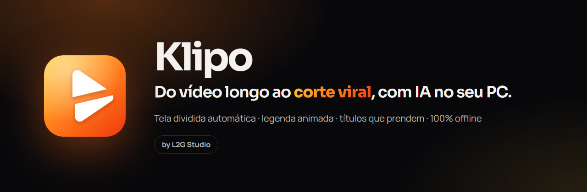
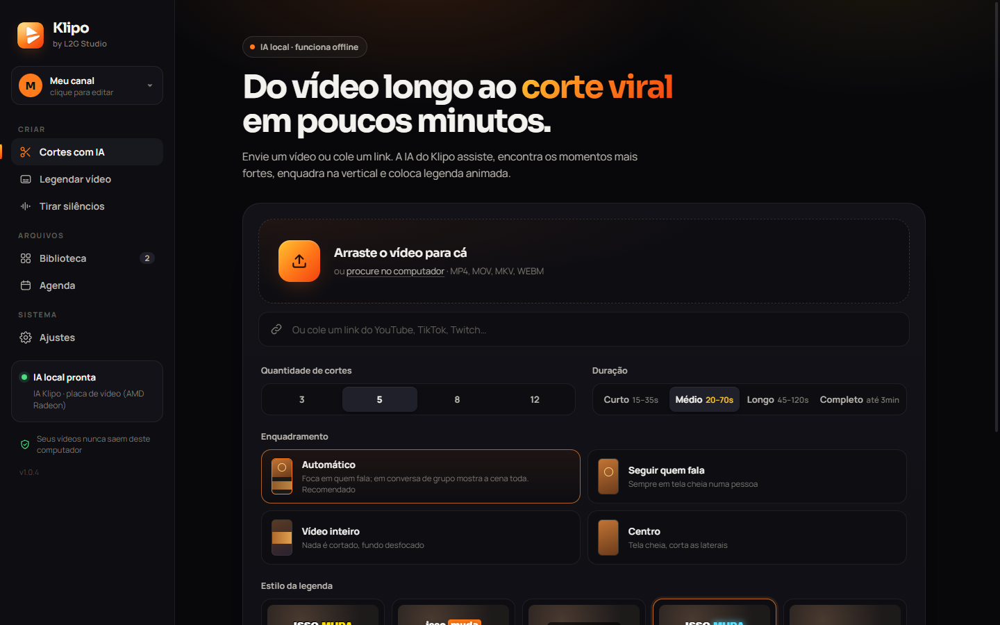
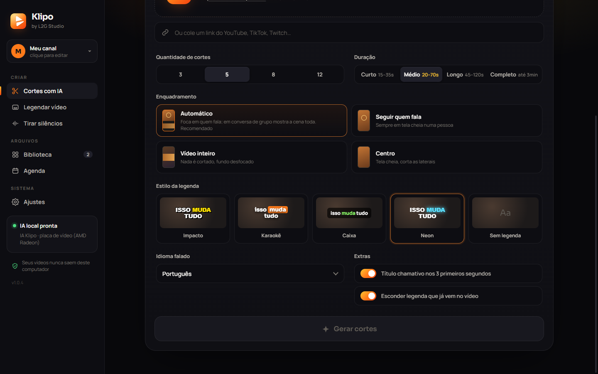
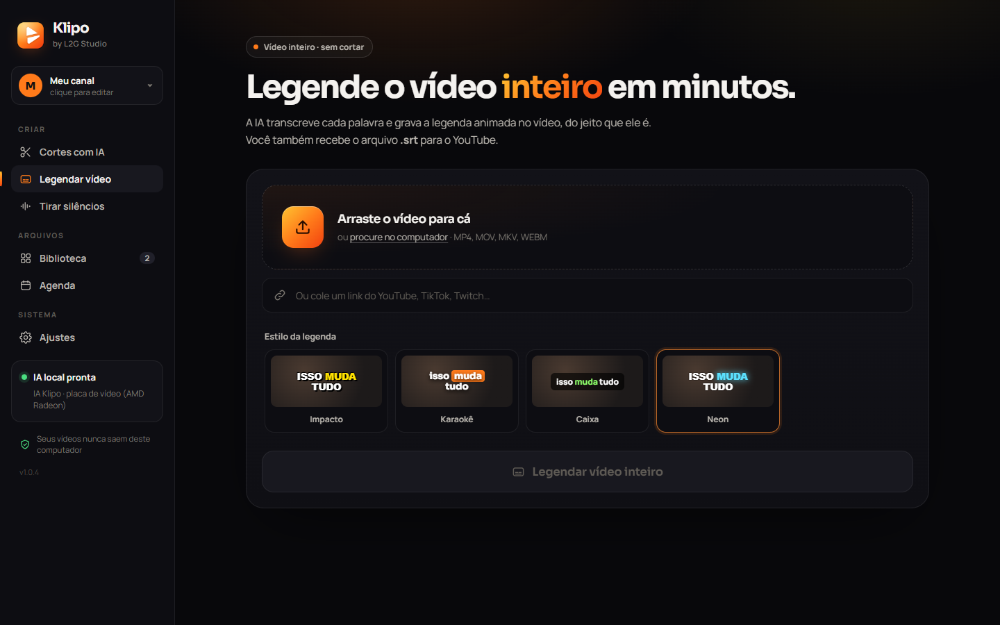
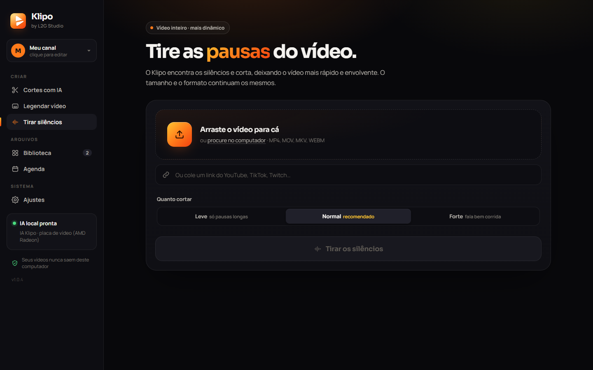
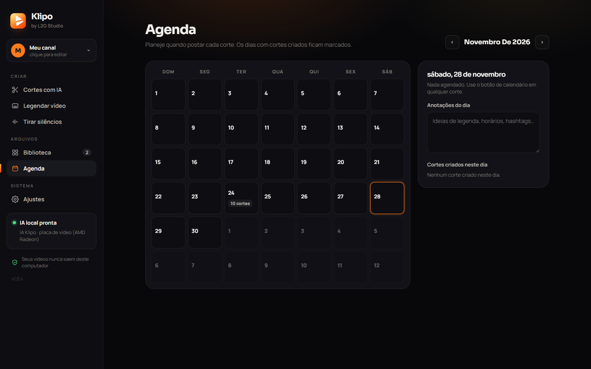
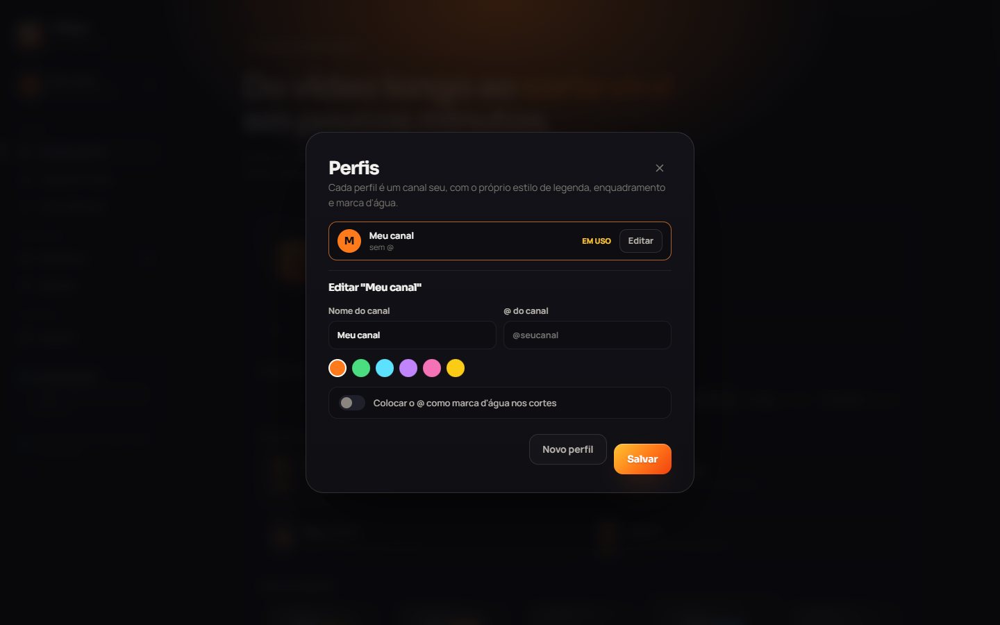

  

  
  
  

<b>Envie um vídeo ou cole um link. A IA do Klipo assiste, encontra os momentos mais fortes, enquadra na vertical e coloca legenda animada — tudo no seu computador.</b>

---

## ⬇️ Baixar

1. Clique em **[Baixar a versão mais recente](https://github.com/IvsonEmanuel22/klipo-releases/releases/latest)** e baixe o arquivo **`Klipo-Setup-x.x.x.exe`**.
2. Abra o instalador. Se o Windows mostrar *"O Windows protegeu o computador"*, clique em **Mais informações → Executar assim mesmo**.
3. Abra o Klipo e cole a sua chave de licença.

Depois de instalado, **o Klipo se atualiza sozinho** — você recebe as novidades sem baixar de novo.

---

## ✂️ Cortes com IA

- **A IA escolhe os melhores momentos:** divide o vídeo em assuntos e escolhe os que têm mais chance de viralizar.
- **Câmera que segue quem fala:** tela dividida automática quando duas pessoas conversam, as duas no mesmo enquadramento quando estão lado a lado.
- **Gancho no início** em letras grandes e **títulos de manchete**.
- **Legenda animada palavra por palavra**, que se posiciona sozinha.
- **Esconde a legenda que já vinha no vídeo original.**
- Cortes **curtos, médios, longos ou com a conversa completa** — sempre terminando no fim do assunto.

---

## 🧰 Mais ferramentas

| Legendar vídeo inteiro | Tirar silêncios |
|:---:|:---:|
|  |  |
| Legenda animada no vídeo completo + arquivo **.srt** para o YouTube. | Remove as pausas (leve, normal ou forte), deixando o vídeo mais dinâmico. |

| Agenda de postagens | Perfis de canal |
|:---:|:---:|
|  |  |
| Planeje quando postar cada corte no TikTok, Reels e Shorts. | Um perfil por canal, com estilo próprio e marca d'água com o seu @. |

---

## 🔒 Privado de verdade

- **Seus vídeos nunca saem do seu computador.** Toda a IA roda localmente — sem nuvem, sem envio, sem fila.
- Funciona **offline** (a internet só é usada para baixar vídeos por link, ativar a licença e receber atualizações).
- Os cortes saem **sem metadados** do vídeo original (localização, aparelho, etc.).

## 💻 Requisitos

| | Mínimo | Recomendado |
|---|---|---|
| Sistema | Windows 10 ou 11 (64 bits) | Windows 11 |
| Memória | 8 GB de RAM | 16 GB de RAM |
| Placa de vídeo | Não é obrigatória | Qualquer placa AMD, NVIDIA ou Intel (bem mais rápido) |
| Espaço | 4 GB livres | 10 GB livres |

## ❓ Perguntas frequentes

**Preciso de internet?** Só para ativar a licença, baixar vídeos por link e receber atualizações. Os cortes são feitos offline.

**Funciona com qualquer vídeo?** Funciona melhor com vídeos com fala: podcasts, entrevistas, lives, aulas, vlogs. Use vídeos seus ou que você tenha autorização para cortar.

**Quanto tempo demora?** Depende do computador. Com placa de vídeo, um vídeo de 15 minutos costuma ficar pronto em cerca de 10 minutos.

---

© 2026 <b>L2G Studio</b>. Todos os direitos reservados. · Componentes de terceiros: veja <code>THIRD-PARTY-NOTICES.txt</code> na pasta de instalação.

